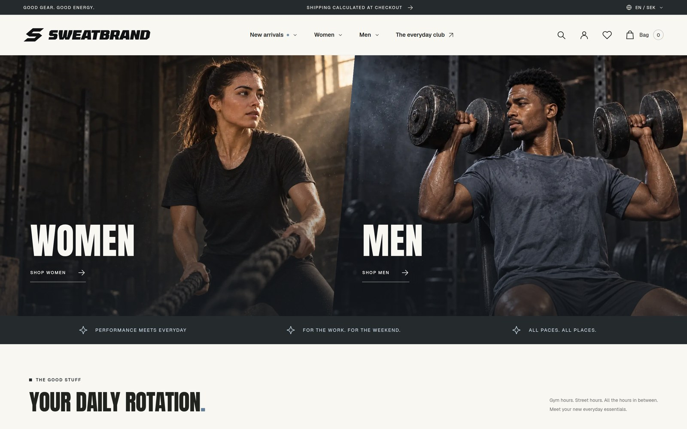
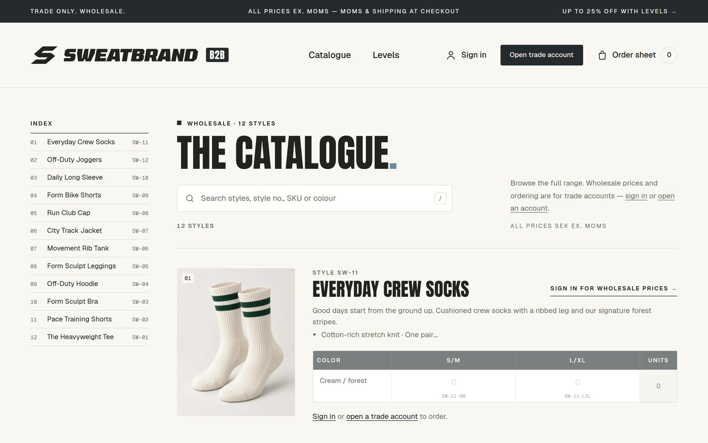
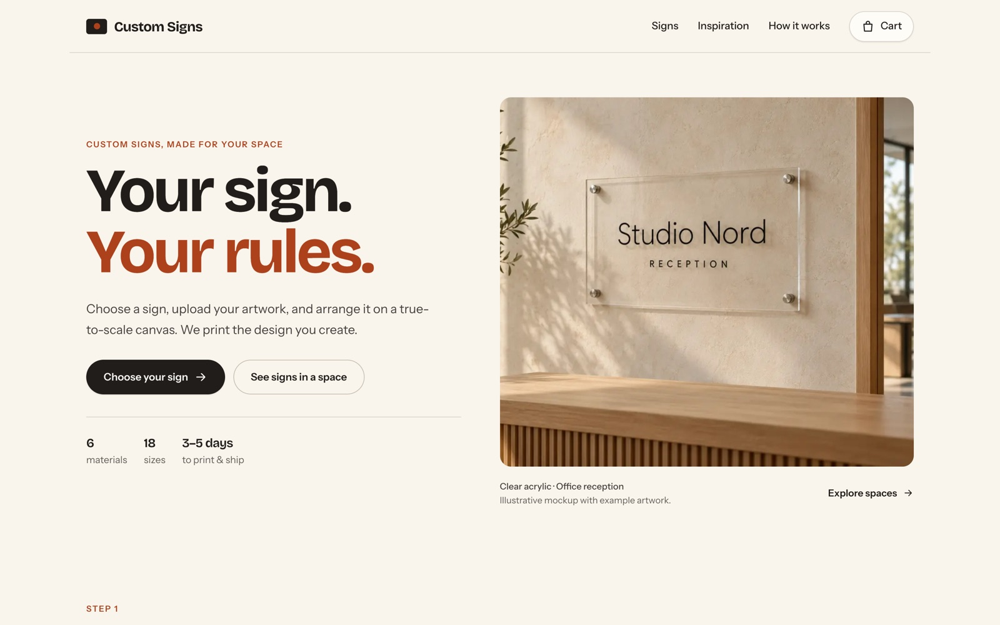

<div align="center">
  
</div>

<div align="center">
  <picture>
    <source
      media="(prefers-color-scheme: dark)"
      srcset="./.github/assets/logos-dark.png"
    />
    <source
      media="(prefers-color-scheme: light)"
      srcset="./.github/assets/logos-light.png"
    />
    
  </picture>
</div>

# Quickbutik Kit

Build your own storefront on Quickbutik. [`@quickbutik/kit`](https://www.npmjs.com/package/@quickbutik/kit) is a bring-your-own-frontend SDK: a storefront API client, React hooks, headless web components and a script-tag build. Quickbutik runs the catalog, cart, customers and the hosted checkout, and you build the frontend in any JavaScript stack.

## Install and use

Everything runs on a publishable key (`qb_pk_…`). Create one under **Custom storefront** in the Quickbutik admin.

```bash
npm install @quickbutik/kit
```

### React

Wrap your app in `ShopkitProvider`, then use the hooks:

```tsx
import { ShopkitProvider, useCart, useCheckout, useProducts } from "@quickbutik/kit/react"

export function App() {
  return (
    <ShopkitProvider config={{ publishableKey: "qb_pk_…" }}>
      <Products />
    </ShopkitProvider>
  )
}

function Products() {
  const { data } = useProducts({ limit: 12 })
  const { add, itemCount } = useCart()
  const { redirectToCheckout, starting } = useCheckout()

  return (
    <>
      {data?.data.map((product) => (
        <button
          key={product.id}
          onClick={() => add({ productId: product.id, variantId: product.variants[0]?.id })}
        >
          Add {product.name}
        </button>
      ))}
      <button
        disabled={starting || itemCount === 0}
        onClick={() => redirectToCheckout({ successUrl: `${location.origin}/success` })}
      >
        Checkout ({itemCount})
      </button>
    </>
  )
}
```

`ShopkitProvider` also shows a cookie banner and loads the shop's own analytics once the shopper agrees.

### Any JavaScript, or on the server

```ts
import { createShopkitClient } from "@quickbutik/kit"

const shopkit = createShopkitClient({ publishableKey: "qb_pk_…" })
const { data: products } = await shopkit.products.list({ limit: 12 })
```

### No build step

Add one script tag and write plain HTML with the kit's web components:

```html
<script defer src="https://cdn.jsdelivr.net/npm/@quickbutik/kit@1.12.0/dist/quickbutik-kit.global.js"
        data-publishable-key="qb_pk_…"></script>

<qb-product slug="cotton-tee">
  <h1 data-qb-text="product.name"></h1>
  <p data-qb-text="price.display"></p>
  <qb-add-to-cart><button>Add to cart</button></qb-add-to-cart>
</qb-product>
```

Full guides and API reference: [quickbutik.dev/kit](https://quickbutik.dev/kit/introduction).

## Examples

Three storefronts, three kinds of shop. Each one is a full Next.js app backed by a real Quickbutik shop, with the hosted Quickbutik checkout for payment. Click a screenshot to open the live demo.

<table>
  <tr>
    <td colspan="2">
      <a href="https://sweatbrand-demo.vercel.app">
        
      </a>
    </td>
  </tr>
  <tr>
    <td width="50%" valign="top">
      <h3>Sweatbrand</h3>
      <p>A street-inspired workout-wear concept store: mega menus, live search, product pages with a variant picker, a cart drawer, and customer accounts with a loyalty club. Available in four languages.</p>
      <p>
        <a href="https://sweatbrand-demo.vercel.app"><b>Live demo ↗</b></a>
        &nbsp;·&nbsp;
        <a href="./examples/nextjs-sweatbrand"><b>Source code</b></a>
      </p>
    </td>
    <td width="50%" valign="top">
      <b>Quickbutik features</b>
      <ul>
        <li>Products, variants (color × size), categories and search</li>
        <li>Server-side cart and hosted checkout in the shopper's language</li>
        <li>Customer login, registration and password reset</li>
        <li>Customer club with points and rewards</li>
        <li>Cookie consent passed on to GA4, GTM and Meta pixel</li>
        <li>SEO and JSON-LD for products, breadcrumbs and the organization</li>
        <li>Thank-you page with order confirmation polling</li>
      </ul>
    </td>
  </tr>
</table>

<table>
  <tr>
    <td colspan="2">
      <a href="https://sweatbrand-b2b.vercel.app">
        
      </a>
    </td>
  </tr>
  <tr>
    <td width="50%" valign="top">
      <h3>Sweatbrand B2B</h3>
      <p>A wholesale storefront for the same brand. Trade customers sign in to see their prices ex. VAT and fill a color × size order grid per style. Discount levels (up to 25% off) come from the customer's group.</p>
      <p>
        <a href="https://sweatbrand-b2b.vercel.app"><b>Live demo ↗</b></a>
        &nbsp;·&nbsp;
        <a href="./examples/nextjs-b2b-sweatbrand"><b>Source code</b></a>
      </p>
    </td>
    <td width="50%" valign="top">
      <b>Quickbutik features</b>
      <ul>
        <li>Customer groups with per-customer pricing</li>
        <li>Prices shown only to signed-in customers</li>
        <li>Trade account registration, login and password reset</li>
        <li>Bulk ordering across variants into one cart</li>
        <li>Customer club</li>
        <li>Cookie consent, hosted checkout and order confirmation</li>
      </ul>
    </td>
  </tr>
</table>

<table>
  <tr>
    <td colspan="2">
      <a href="https://custom-signs-demo.vercel.app">
        
      </a>
    </td>
  </tr>
  <tr>
    <td width="50%" valign="top">
      <h3>Custom Signs</h3>
      <p>A made-to-order shop with a sign designer. Shoppers pick a material and size, then arrange images and text on a true-to-scale canvas. The finished design is attached to the order, ready to print.</p>
      <p>
        <a href="https://custom-signs-demo.vercel.app"><b>Live demo ↗</b></a>
        &nbsp;·&nbsp;
        <a href="./examples/nextjs-custom-fields"><b>Source code</b></a>
      </p>
    </td>
    <td width="50%" valign="top">
      <b>Quickbutik features</b>
      <ul>
        <li>Product fields (<i>produktfält</i>) that carry a design link on each cart line</li>
        <li>Variants for sign sizes, SKU-based materials</li>
        <li>Cart with one line per unique design</li>
        <li>Hosted checkout and order confirmation</li>
      </ul>
    </td>
  </tr>
</table>

## Build with AI agents

The [Quickbutik agent plugins](https://github.com/quickbutik/agent-plugins) teach Claude Code and Codex how to build storefronts with the kit. They also connect the agent to your shop through the Quickbutik MCP server.

### Claude Code

```bash
claude plugin marketplace add quickbutik/agent-plugins
claude plugin install quickbutik@quickbutik
```

Restart Claude Code. To connect your shop, run `/mcp`, select **quickbutik** and log in with your Quickbutik account.

### Codex

```bash
codex plugin marketplace add quickbutik/agent-plugins
codex plugin add quickbutik@quickbutik
codex mcp login quickbutik
```

Building a storefront needs no login. The agent asks for your publishable key (`qb_pk_…`, from **Custom storefront** in the Quickbutik admin) when it needs it. See the [full installation guide](https://github.com/quickbutik/agent-plugins#readme) for updating, uninstalling and private-repo access.

## Contribute

The kit's source is in [`packages/kit`](./packages/kit). It has no runtime dependencies: requests go through its own small HTTP client in [`src/sdk/http.ts`](./packages/kit/src/sdk/http.ts).

### Setup

You need Node 18 or later and pnpm:

```bash
git clone git@github.com:quickbutik/kit.git
cd kit/packages/kit
pnpm install
```

### Develop

Run everything from `packages/kit`:

```bash
pnpm test:watch   # unit tests (Vitest + happy-dom) in watch mode
pnpm test         # unit tests, once
pnpm typecheck    # tsc --noEmit
pnpm lint         # Biome
pnpm build        # tsup, then bundle and entry-point checks
```

The integration suite (`test:integration`) runs a cart → login → order flow against a live gateway. The header of [`tests/integration/storefront.integration.test.ts`](./packages/kit/tests/integration/storefront.integration.test.ts) lists the environment variables and shop setup it needs.

### Try a change in a storefront

Build and pack the kit, then install the tarball in one of the [examples](#examples):

```bash
cd packages/kit && pnpm build && pnpm pack
cd ../../examples/nextjs-sweatbrand && pnpm add ../../packages/kit/quickbutik-kit-<version>.tgz
```

### Open a pull request

1. Branch off `main` and keep the change focused.
2. Add or update tests next to the existing ones in `tests/`.
3. Describe the change in [`CHANGELOG.md`](./packages/kit/CHANGELOG.md). Public API changes are a minor bump and fixes are a patch.
4. Make sure `test`, `typecheck`, `lint` and `build` pass, then open the PR against `main`.
